# Architecture

```mermaid
flowchart LR
  A["data/raw lecture PDFs"] --> B["ingest / hash scan"]
  B --> C["data/index.json"]
  C --> D["PDF Parser Skill"]
  D --> E["Concept Filter Skill"]
  E --> F["data/processed/<course>/<lecture>/lecture.md + lecture.json"]
  F --> G["Knowledge Consolidator Skill"]
  G --> H["knowledge_base/concepts"]
  H --> I["Evaluation Pipeline (LLM-as-a-Judge)"]
  I --> J{"Quality Gate"}
  J -->|pass| K["Impeccable Skill"]
  K --> L["knowledge_base/refined"]
  L --> M["Knowledge Graph Builder Skill"]
  M --> N["knowledge_base/graphs/nodes.json + edges.json + graph.json + state.json"]
  N --> O["Graph Visualization"]
  O --> P["Interactive Website"]
```

## Design choice

- Keep source parsing separate from ingestion state.
- Keep lecture artifacts separate from canonical concept records.
- Keep canonical concept records separate from graph edges.
- Keep provenance attached at every hop.
- Keep ingestion incremental by hash, not by filename.
- Keep consolidation incremental by canonical concept key.
- Keep evaluation ahead of presentation refinement.
- Keep Impeccable as a presentation-only layer.
- Keep refined output separate from draft concept records.
- Keep graph building incremental by canonical concept key and relation fingerprint.
- Keep PDF parsing behind a single adapter until a real importable Anthropic Python API exists.

## Planned shared layer

`src/knowledge_review_agent/` is reserved for shared schema, provenance, and utility code used by all skills.

## Persistent state

- `data/index.json` tracks PDF hashes, status, and output locations.
- `knowledge_base/concepts/<concept>/metadata.json` tracks canonical provenance and versioning.
- `knowledge_base/graphs/` tracks node, edge, state, and delta data.
- `evaluation/` tracks merge-quality checks for concept consolidation.
- `website/` renders refined knowledge for users.
