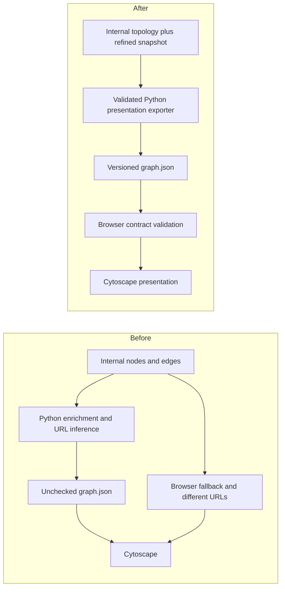

# Graph presentation contract

Status: implemented and verified on 2026-10-20 after user approval. 237 Python and 33 Node tests pass; synthetic browser smoke passes. Production graph/refined files unchanged. See completed implementation plan for review findings and limits.

## Intent and success criteria

User selected fourth architecture improvement: deepen graph presentation contract.
Goal: graph generation exports a complete validated presentation bundle; website
consumes that contract without rebuilding relationships, inferring local checkout
paths or silently switching to a different data shape.

Preserve prior persistence, evaluation/refinement and source occurrence work on
current `superpowers-dev` checkout. Native execution preference remains in effect.
Baseline verified: 178 tests pass. Current packaged schema-1 bundle has 66 nodes,
159 edges, no missing endpoints and 66 existing refined concept targets. These
observations establish compatibility baseline, not new quality evaluation.

No production ingestion, evaluation, refinement or graph regeneration during this
improvement. Do not modify existing concept pages, graph bundles, state/deltas,
raw PDFs or unrelated image. Implementation tests use temporary synthetic trees
and a temporary minimal static submission. Current shipped site must keep working
without `data/`, draft concepts or a build step.

## Observed problems

- `graph_bundle.py` mixes file reads, Markdown interpretation, URL/root guessing,
  enrichment, statistics and direct unvalidated publication. Repository root is
  inferred from graph output location, so custom output paths alter URL meaning.
- Bundle enriches from a node's draft metadata/Markdown while viewer link points
  to refined content. Graph detail and opened page can describe different versions.
- `_concept_viewer_url` uses unrestricted string replacement and raw query text;
  filenames containing URL delimiters can alter target identity.
- Export accepts dangling endpoints/duplicate IDs without explicit validation.
  Existing bundle unit test even supplies missing source node `calculus`.
- Browser `buildFallbackGraph` expects `source`/`target`, but internal `edges.json`
  contains `source_node_id`/`target_node_id`. This is a broken second producer.
- Browser trusts successful `graph.json` responses without schema/topology checks;
  repeated defaults hide malformed fields and duplicate URL construction logic.
- Every export writes a new timestamp and file even when presentation unchanged.
  Direct write can expose truncated JSON on interrupted publication.
- Existing graph evaluation examines internal nodes/edges, not actual browser
  payload or packaged refined links. Its heuristic score is not a contract check.

## Alternatives

1. **Single validated presentation bundle (recommended).** Deepen existing Python
   exporter; add small pure browser loader/validator; share normative contract and
   valid/invalid fixtures. Retain checked schema-1 compatibility, remove raw-state
   fallback. No additional durable graph state.
2. **Repair browser fallback.** Adds another adapter but preserves two producers,
   divergent URL/stats rules and incomplete enrichment when metadata absent.
3. **Generate browser contract code from a schema toolchain.** Useful at larger
   scale, but adds build/dependency infrastructure not justified by this static site.

Select option 1. Python owns bundle production; JavaScript validates consumption.
Validation in two languages is deliberate; fixture parity pins behavior. Browser
must not synthesize graph content or statistics to rescue invalid input.

## Before and after

Deepen `graph_bundle.py` rather than introduce a generic graph framework. Keep
`graph_builder.py` responsible for canonical topology/state/deltas. Browser module
owns loading/contract checks only; `app.js` keeps search, filters and Cytoscape UI.
No layout/style redesign, relationship inference change or automatic enrichment.

## Versioned payload

New exports use `schema_version: 2`. Keep current top-level `generated_at`, `stats`,
`nodes`, `edges` and existing node/edge field names from bundle dataclasses.
Document normative field types/ranges and required fields in repo-local contract
documentation; shared fixtures exercise Python exporter/validator and pure browser
validator. No runtime schema-fetch dependency or generic validation engine.

Validation requires:

- Object root, supported integer schema version, valid timestamp and correctly
  typed required fields. No numeric/string/bool coercion; finite numeric values.
- Nonempty unique node IDs and canonical concept keys. Node and edge IDs share
  Cytoscape's global ID namespace, so collisions across kinds also fail.
- Unique edge IDs; source and target IDs exist; endpoint concept keys agree with
  referenced nodes; `target_resolved` is boolean true. No self edges.
- Relations remain exactly `prerequisite` and `related`, matching current builder.
  Do not reverse directions, add missing nodes, drop malformed edges or infer links.
- Scope/importance/study-priority are integers 1..5. String-list and source-hash-map
  fields retain declared types and provenance. Supporting hash values remain
  opaque provenance strings; do not invent full PDF/hash verification here.
- Degree/connected-edge-count equal actual incident edge count. Stats exactly match
  nodes, edges, distinct sorted nonblank domains, multi-course count and relation
  counts. Average degree = 2E/N, rounded to two decimals with nonnegative half-up
  rule (0 for empty graph), identically in both validators. Isolated nodes are valid.
- Empty nodes plus empty edges is valid presentation data; show existing empty
  state. Building from empty concepts remains existing CLI error, separate policy.

Keep educational strings/citations intact. Display formatting may use existing
fallback labels for optional empty content, but malformed required fields cannot
be converted into plausible data. Missing required node fields or raw internal
`nodes.json`/`edges.json` shapes are not presentation bundles.

## Explicit paths and refined snapshot

Exporter accepts explicit repository/site/refined/source-concepts roots. Graph
output location must not determine URL meaning. CLI supplies project defaults;
custom source/site/refined layouts must be explicit and testable. Keep existing
public export wrappers with keyword path configuration, failing clearly when
legacy inferred configuration cannot safely resolve a published concept.

Resolve each topology node's metadata path relative to declared source-concepts
root (or declared refined root), then map same relative concept directory to
refined metadata/Markdown. Never use substring replacement of folder/file names.
Require complete real regular refined records inside allowed root, no symlink
escape, no path traversal, and actual files before publication. Do not create
refined pages or read drafts as enrichment fallback.

Capture exact refined metadata/Markdown bytes once and enrich from those bytes.
Use shared fence-aware concept document parser; fenced headings do not become
summaries, and duplicate sections retain original content. No generated prose.
Reject canonical identity/version or graph-defining metadata disagreement between
node and refined record (name/key, classification, ranks, courses and lectures).
This prevents publishing fresh topology against older refined pages. Existing
canonical metadata defaults remain compatible where field omitted historically.
Do not invoke readiness evaluation or source occurrence parsing here.

Presentation `metadata_path` becomes repository-relative refined metadata path in
v2. `metadata_url` resolves from website directory to that same refined file.
`concept_url` targets site's concept viewer with `path` query pointing to same
refined directory's Markdown file. Encode URL path segments, then encode resulting
relative URL as query value; after URLSearchParams decoding and new URL resolution,
spaces, Unicode, literal percent signs, #, &, ?, and nested directories must still
identify original file. Reject absolute filesystem leakage, external schemes,
network URLs and targets outside declared published roots. Browser validates
resolved same-origin published paths, not string-prefix lookalikes.

Protect same path rule in concept-viewer entry point for graph-provided/direct
`path` values; invalid path shows clear error before Markdown fetch. Preserve valid
legacy links. Broader Markdown sanitization and site security work are out of scope.

## Publication and no-op behavior

Prepare complete payload and validate all records, URLs, endpoints and stats
before touching published `graph.json`. On validation/read failure, preserve
existing bundle bytes/mtime or leave absent output absent. Expose structured errors
with affected node/edge/path and CLI nonzero status; no traceback as normal input
failure. Reject output overlap with refined/source input records or symlink output.

Sort nodes/edges and set-like lists deterministically. Compare semantic payload
(schema/stats/nodes/edges, excluding generated_at) against existing valid bundle.
If unchanged, leave bytes/mtime and previous generated_at untouched even when caller
supplies newer timestamp. On meaningful change, use supplied timestamp and atomic
sibling-temp-file replace. Exporter never writes internal graph state/deltas. Internal builder retains its
own incremental policy; a presentation no-op does not imply a topology-state no-op.

Internal topology build may finish before presentation export rejects a mismatch;
CLI must report presentation failure and preserve previous presentation bundle.
This is not a transaction across graph.json, internal graph files or concept pages.
Single-writer assumptions remain. No claim of crash-atomic whole-site deployment.

## Browser loading and schema-1 compatibility

Browser fetches `graph.json` only and validates before setting app state or creating
Cytoscape. Missing/non-OK response, invalid JSON, unsupported version, bad URLs or
invalid graph displays useful load error. Do not fetch internal nodes/edges or
silently fall back after failure. Remove duplicated browser URL/stats producer and
repair-style defaults once validated payload supplies required fields.

Accept current complete schema-1 presentation bundles through one explicit legacy
adapter. Validate topology, required fields, stats and actual published URL shape;
legacy metadata_path may name ignored drafts, so adapter uses validated refined
metadata_url as authoritative normalized path and never fetches draft metadata.
Do not rebuild statistics, edges or summaries. Existing packaged bundle must load
without regeneration or `data/`. Unsupported older/raw shapes fail clearly.

New Python exports are v2; existing v1 graph file remains untouched by this task.
Both supported versions pass shared consumer fixtures. Old v1 links with valid
spaces and current viewer query form remain supported. Ambiguous malformed legacy
URLs are rejected, not guessed. Static submission tests follow final URLs and
read actual refined metadata/Markdown from packaged files only.

## Graph evaluation and verification

Keep current internal graph metrics API/result unchanged and label them diagnostic.
Add explicit presentation-check mode to graph evaluation CLI so missing/invalid
bundle produces structured failure/nonzero status. Reuse exporter contract
validation rather than independently recounting graph structure again. Presentation
check does not require data/, drafts, graph state/deltas or full readiness evaluation.

Acceptance tests use temporary records/shared fixtures and Node's built-in test
runner (available locally), without new npm/Python runtime dependencies:

1. Valid v2 export and complete v1 consumption; empty graph; strict field types,
   duplicate/colliding IDs, missing source/target, key disagreement, unknown relation,
   self edges, wrong counts, non-finite numeric values and unsupported schema.
2. Python/browser fixture parity: accepted payloads preserve content; same invalid
   corpus rejected before Cytoscape, with actionable errors and no raw-file fallback.
3. Explicit roots/custom output directories, nested concepts, special URL characters,
   shared fence-aware parsing, missing/outdated refined records and symlink escapes.
4. Invalid last record causes no graph.json changes; unchanged rerun retains exact
   bytes/mtime/timestamp; changed data atomically replaces complete valid bundle.
5. Synthetic submission contains only website, refined records and graph.json:
   load graph/search/select/open concept successfully; no dependency on data/,
   drafts, internal nodes/edges, graph state or external enrichment. Real Cytoscape
   may remain external runtime as currently shipped; pure loader tests stub graph
   initialization, not contract validation.
6. Current full Python suite remains green, native JavaScript tests pass, compile
   and diff checks pass. Existing packaged bundle receives read-only compatibility
   check; never regenerate production outputs as a test.

## Review state

Self-reviewed scope: deepen exporter/consumer contract, keep graph state generation
separate, retain current static submission via explicit v1 adapter. Approved native
implementation and fresh review completed; production data and generated artifacts
unchanged. Source/spec/plan stay uncommitted under approved sandbox fallback.

Implementation plan: [graph presentation contract](../plans/2026-10-20-graph-presentation-contract.md), completed with verification evidence, review fixes and deferred limits.
