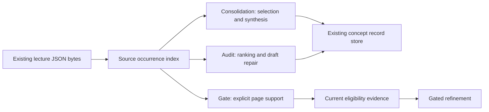

# Shared source occurrence tracking

Status: approved and implemented on 2026-10-20; 178 tests pass after one fresh-context review and regression fix pass.

## Intent and success criteria

User selected third architecture improvement: deepen source occurrence tracking.
Goal: consolidation, quality audit/repair and publication evaluation refer to
same source locations without duplicating lecture discovery and identity rules.
Every evidence match must retain its source artifact hash, course, lecture,
page and exact source wording. Repeated wording across sources must retain all
citations. Source presence must not imply factual verification or merge approval.

Preserve completed persistence and evaluation/refinement changes on current
`superpowers-dev` checkout. Current baseline: 117 tests pass. Existing work and
`KRA-presentation.png` remain untouched. No production ingestion, consolidation,
audit/repair, evaluation, refinement or graph builds during implementation.

## Observed problems

- `consolidation.py` owns `LectureArtifact`, filesystem discovery, page walking,
  structured/candidate matching and evidence selection alongside synthesis.
- `concept_quality.collect_source_evidence` rereads every lecture for each concept.
  It searches extracted text across allowed courses, rather than restricting
  repair evidence to declared contributing lectures and their expected hashes.
- Audit ranks evidence then deduplicates by lowercase text. Identical evidence
  from multiple courses/pages loses citations; display limit also hides coverage.
- `quality_gate.py` separately walks structured concepts and candidate labels.
  Accepted label spellings, course fallback and page validation can drift from
  consolidation and audit. Previous empty-alias defect illustrates this risk.
- Canonical metadata preserves lecture-level hashes; exact page evidence lives
  in processed JSON and Markdown. Adding another persistent corpus database would
  duplicate existing state and require independent migration/recovery rules.

## Alternatives

1. **Shared in-memory occurrence index (recommended).** Build once from existing
   lecture JSON per command or captured evaluation corpus. Own structural source
   validation, page identity, exact evidence and lookup. Keep synthesis/ranking
   in their current modules. No additional durable state or implicit migration.
2. **Persist occurrences in every canonical metadata record.** Convenient local
   lookup, but duplicates lecture artifacts and complicates incremental merging,
   old-record compatibility and stale occurrence replacement.
3. **Persist repository-wide occurrence database.** Can speed large corpora, but
   adds transactions, invalidation and recovery beyond demonstrated needs.

Select option 1. Revisit durable indexing only after measured lookup cost warrants
it. Hash-driven PDF ingestion and canonical-record persistence stay authoritative.

## Architecture

Before: three consumers independently discover/match source pages.
After: one concrete module owns source occurrence discovery and lookup; callers
retain domain-specific decisions.

`src/knowledge_review_agent/source_occurrences.py` owns concrete source records,
validation, exact locators, deterministic ordering, identity matching and lookup.
It contains no concept profiles, educational quality scores, generated prose,
canonical record writes, PDF parsing or presentation logic. No protocol/plugin
abstraction: current filesystem and gate snapshots supply same lecture bytes.

## Source records and occurrence identity

Each source record carries processed-relative lecture path, SHA-256 of exact JSON
bytes, PDF path if present, course ID/name and declared page inventory.

Each occurrence carries:

- source record identity and enclosing positive page number;
- exact JSON pointer identifying structured concept, candidate or extracted-text
  field; text-line occurrences also retain line number and character offsets;
- source kind: `structured`, `candidate` or `text_line`;
- original label(s), nonempty normalized identities and exact source text;
- exact page heading/context, source PDF path and structured source fields needed
  by consolidation, without replacing them with generated enrichment;
- deterministic occurrence ID derived from policy version, lecture-relative path,
  lecture hash and locator (JSON pointer plus line offsets when applicable)
  using canonical JSON and SHA-256.

A changed lecture hash creates new occurrence identities, even if wording stays
same. Distinct source locations remain distinct occurrences, including identical
text on two pages/courses or repeated structured entries. Grouping for display
must retain all occurrence IDs and citations. Display text may be cleaned by audit
or consolidation; raw source text and locator remain available alongside it.
No timestamps, absolute checkout paths or process-dependent Python hashes in IDs.

## Structural validation and matching

Validate finite JSON object shapes, course metadata, positive integer page count,
unique positive page numbers within declared bounds, page/item/list types and
nonempty identities before matching. Boolean/string page numbers do not count as
integers. Do not guess missing page numbers. Missing optional evidence text is
represented as missing, not replaced by a generated quotation.

Unsafe relative paths, symlink source inputs, conflicting item-level source
page/PDF declarations and malformed artifacts produce explicit deterministic
source issues. An omitted optional item source declaration uses enclosing lecture
and page identity; conflicting declarations never silently override it.

One course identifier rule: nonempty `course_id`, otherwise `course_name`.
Keep both original fields. No invented course name. Missing both remains an issue.

Shared exact matching uses nonempty normalized canonical key/name/label/alias
identities. Support existing structured label spellings (`concept_name`,
`concept_label`, `name`, `title`) and explicit candidate labels. Explicit nonempty
canonical keys take precedence over a conflicting display-name match. Do not use
substring matching, fuzzy matching or concept profiles to establish gate support.
Blank/punctuation-only aliases never match missing source labels.

Raw text search remains available for audit discovery, with its existing quality
filters. A text substring match does not become structured support. Existing
canonical naming/profile logic remains consolidation policy, separate from source
identity; preserve original labels through that transformation.

## Narrow interface and lifecycle

Provide source-record discovery/loading from processed root and construction from
an iterable of exact `(relative lecture path, bytes)` records. Return index plus
explicit source issues; retain bytes/hashes for caller use. Query index using
concept identity/aliases, optional contributing lecture/hash scope and source
kinds. Results expose all matching occurrences in stable source/page/locator order.

Filesystem loading reads each lecture once per command, hashes those same bytes,
and never writes source files. Gate construction consumes already captured bytes
through its existing manifest reader and does not reread mutable files outside
snapshot capture. Identical input ordering changes must not change outputs.

Malformed source issues cannot disappear as an empty successful search. Audit
reports issues and blocks repair for affected concept scope. Consolidation aborts
before canonical writes when source discovery cannot safely establish its corpus;
it must not treat unreadable input as a removed lecture. Gate translates relevant
issues into existing hard source failures and persists blocked evidence.

## Consumer integration

### Consolidation

Move source record discovery/page occurrence walking to shared module. Preserve
public compatibility wrappers for `LectureArtifact`, discovery and mention helpers
where callers/tests currently use them. `ConceptMention` remains a synthesis input;
importance thresholds, candidate fallback, named profiles and content generation
remain consolidation choices. Candidate-only fallback behavior stays unchanged.

Carry occurrence identities through mention construction for traceability. Shared
source occurrence count is distinct from consolidation's selected mention count.
Do not silently change educational selection or canonical content policy.

Existing source hashes continue to drive affected-key updates. Unchanged records
must retain bytes, version and mtime. No bulk page rewrite to add occurrence IDs.
No new metadata state is required. Source changes continue to archive prior
canonical bytes through existing record store.

### Quality audit and draft repair

Build one index before concept loop. Keep current public collector compatible;
allow caller to supply index and explicit lecture/hash scope. Existing course-only
lookup remains discovery-only; command's apply path must use contributing lecture
paths and expected hashes plus existing course exclusions.

Rank and cap displayed evidence groups using current scoring. Within each group,
retain all exact source occurrences. Audit report includes full matched coverage
and source issues separately from display selection. Existing primary citation
fields remain compatible; grouped occurrence references add full provenance.
Limit zero returns no display groups. Sorting/ties remain deterministic.

Repair can use evidence only from valid declared source hashes. Missing/changed
hash, unsupported source page, or evidence available only from another lecture in
same course prevents affected repair and produces a clear report entry. No automatic
addition of new lectures, approvals or external evidence. Empty evidence cannot
be relabeled source-backed. Repairs remain draft-only through record store and
invalidate earlier eligibility evidence.

### Evaluation/refinement gate

Replace independent source-page matching with shared index over captured relevant
lecture bytes. Continue requiring every contributing lecture/course/hash to have
explicit bounded page support. Text-only matches do not satisfy this condition.
Candidate labels retain existing status as page-presence evidence, not definition
verification. Return unique supported page tuples, even with repeated occurrences.

Keep report's supported-page/reviewer citation shapes compatible. Bump gate policy
version because source interpretation changes; old policy reports reject clearly
and require reevaluation. No conversion or invented reviewer decisions.

Final prepublication check remains dependency-only: hashes, roots, membership and
path safety. Never rebuild occurrence index or rerun content policy after formatting.

## Compatibility and boundaries

- No raw PDF parsing, mutation or unchanged-PDF reprocessing.
- No new database, CSV state, global cache or generated submission bundle.
- Legacy concept metadata remains loadable without occurrence fields.
- No canonical/refined page migration; no graph or website changes.
- No external network lookup, LLM extraction, quiz or interview features.
- Existing complete canonical snapshots/provenance remain intact.
- Existing single-writer/per-file publication limitations remain documented.
- Source occurrence verifies location and wording, not truth of every claim.

## Verification and acceptance

Use synthetic temporary lecture JSON and canonical-record fixtures only.

1. Same bytes yield stable IDs and lookup order regardless of input iteration;
   changed bytes yield changed IDs. UTF-8 wording, equations and raw evidence
   remain exact. Same wording across sources retains every location.
2. Cover structured label variants, explicit key precedence, aliases, candidate
   labels, text-only search, empty aliases and unrelated same-course lectures.
3. Cover malformed/nonfinite JSON, missing/duplicate/out-of-range pages, bad list
   shapes, unsafe paths, symlinks and conflicting source declarations. Failures
   remain reportable and never become fabricated page evidence.
4. Cover one source read per command, index reuse across audit concepts, display
   limits without citation loss and complete coverage reporting.
5. Repairs reject changed/missing hashes, unsupported pages and unrelated lecture
   evidence; valid repairs archive prior bytes, leave refined output untouched
   and stale prior gate reports.
6. Gate consumers agree on occurrence identities while retaining distinct policies;
   candidate presence never becomes definition proof; prior-policy reports block.
7. Consolidation fixtures retain selection behavior, prior source attributions,
   no-op bytes/versions/mtimes and affected-key-only writes.
8. Preserve phase-ordering regression: final freshness invokes no content evaluator
   or occurrence parsing after formatter. Run complete existing suite, compileall
   and diff checks. Inspect status for unexpected production changes.

## Review state

Self-review: selected one shared module, no second durable state, explicit consumer
policies, compatibility/no-op contract, gate policy invalidation and repair source
scope. Implementation and review evidence recorded at `docs/superpowers/plans/2026-10-20-source-occurrence-tracking.md`. Source reads occur once per command; compatibility wrapper's extra JSON decode remains a deferred minor. Spec remains uncommitted under
existing sandbox fallback for current checkout; no Git mutation attempted.
